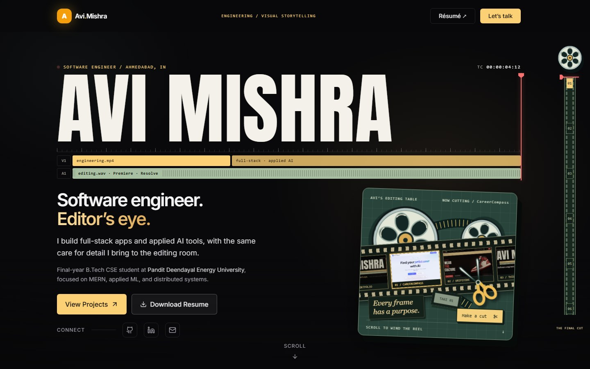
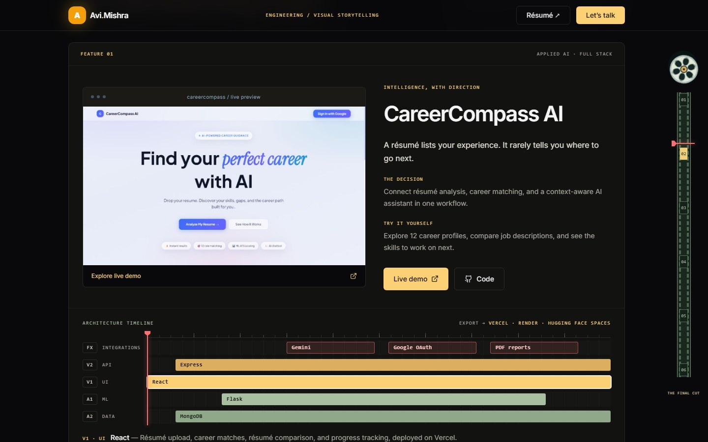
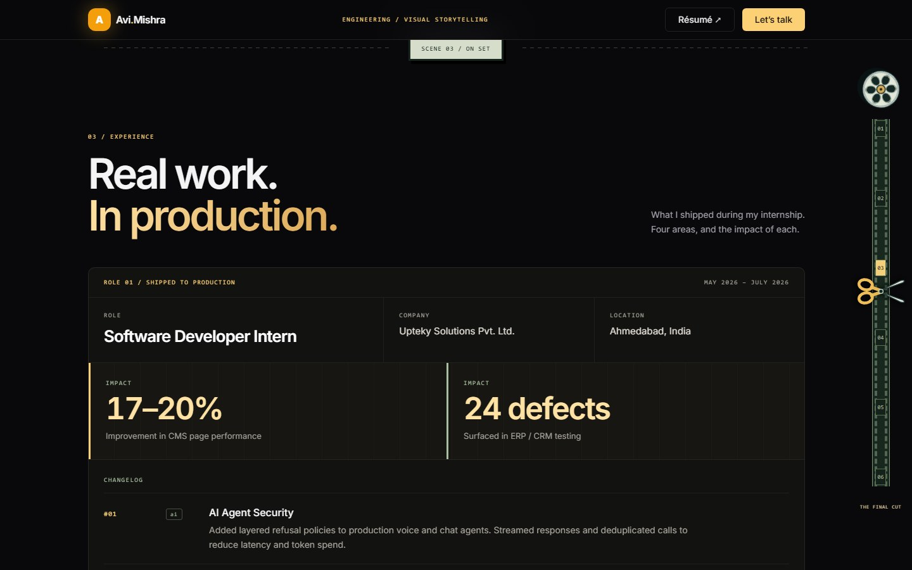
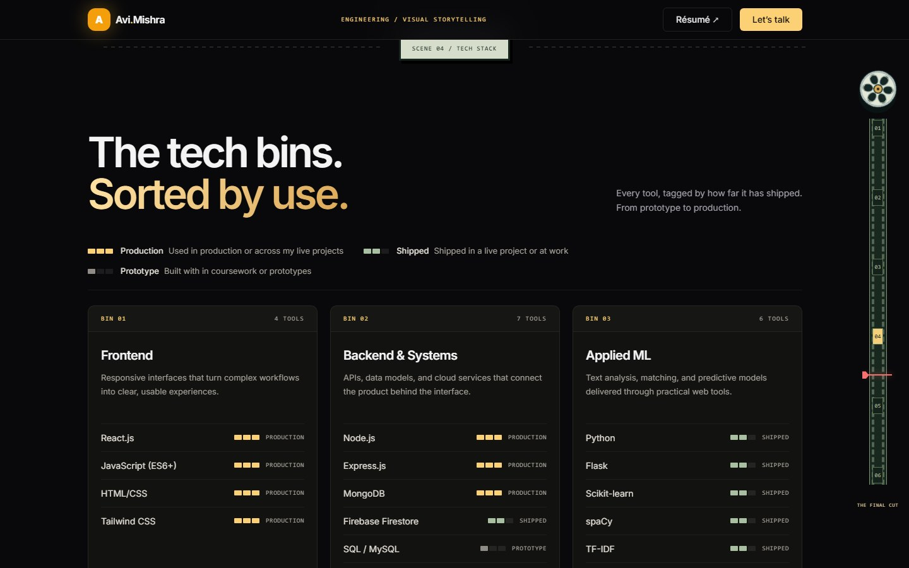
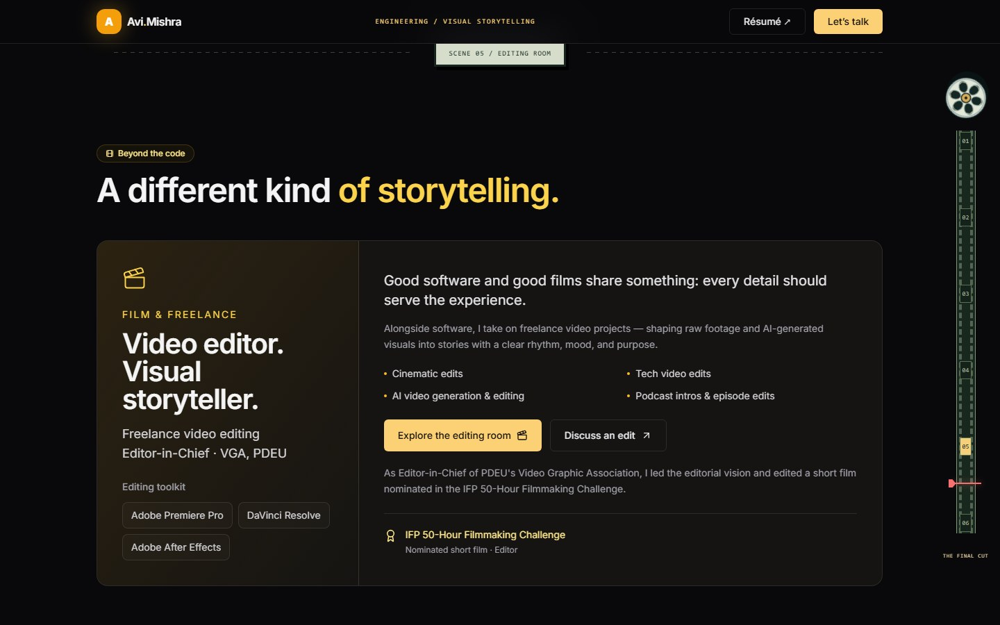
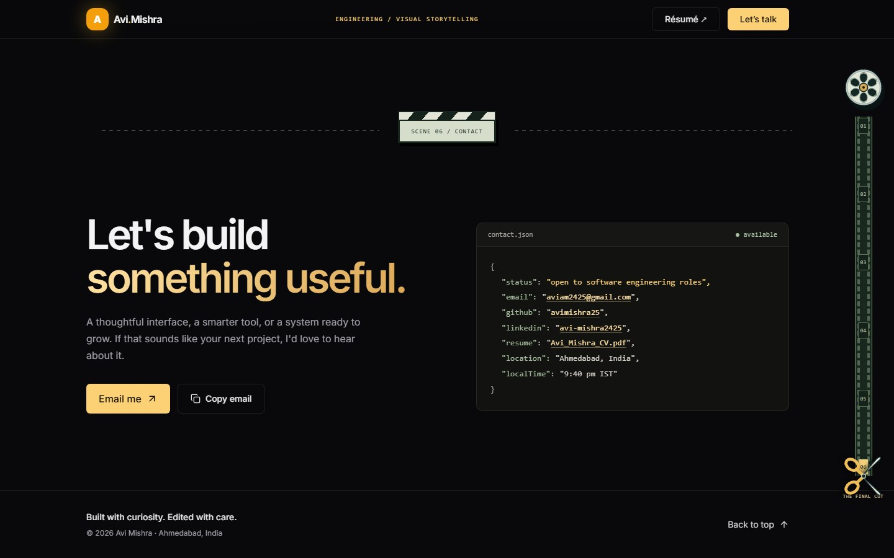
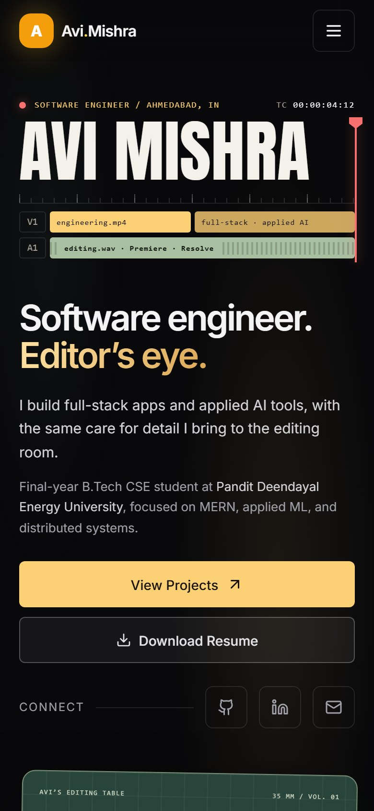

# Avi Mishra — Portfolio

> Software Engineer · Full-Stack & Applied ML · Freelance Video Editor

A personal portfolio built with React, Vite, Tailwind CSS, and Framer Motion. It presents software projects and engineering experience first, framed with a video editor's eye: the name sits on an editing timeline, sections are cut like scenes, and a film-reel rail tracks your place on the page.

**Live:** [portfolio-avimishra25s-projects.vercel.app](https://portfolio-avimishra25s-projects.vercel.app/)

## Screenshots



| Projects | Experience |
| --- | --- |
|  |  |
| **Tech stack** | **Editing room** |
|  |  |
| **Contact** | **Mobile** |
|  |  |

## Highlights

- **Timeline title hero:** the name is set in large condensed type on an editing timeline, with V1/A1 tracks, a ruler, and a timecode. On load, a playhead sweeps across and reveals it. The hero is sized so the name, tagline, buttons, and editing desk fit in the first screen on laptops.
- **Editing desk:** an illustrated desk whose film strip carries the projects (CareerCompass AI, DripStore, and this portfolio). "Make a cut" slides the strip to the next project and lights its frame, while the reels wind as you scroll.
- **Selected work:** CareerCompass AI and DripStore, each told as the problem, the key decision, and what you can try in the live demo. Technical details and the full stack sit in an expandable "Inside the build" panel.
- **Architecture timelines:** each featured project's stack laid out as editing tracks: FX for integrations (Gemini, Google OAuth, Razorpay, Cloudinary), V2 for the API, V1 for the UI, and audio tracks for the ML service and database, with the deployment target as the export. Hovering, focusing, or tapping a clip moves a playhead to it and explains that layer.
- **Experience:** the internship as release notes, with role details, animated impact metrics (17–20% CMS performance improvement, 24 defects surfaced), and a numbered changelog.
- **Tech stack:** tools grouped into tech bins and tagged **Production**, **Shipped**, or **Prototype** by how far each has gone.
- **Editing room:** freelance editing services, toolkit, and the IFP 50-Hour Filmmaking Challenge nomination, linking to a separate page of selected edits.
- **Selected edits page:** four thumbnail-led videos with native playback. Video files load only after a click, and only one player is mounted at a time.
- **Contact:** email and copy-email (with a manual fallback), beside a `contact.json` panel with links, resume, and live local time.
- **Navigation:** a film-reel chapter rail with a playhead that tracks the current section, running down the right edge on wide screens and along the bottom on phones and tablets. Grab and drag the rail to scrub through the page like a timeline, or tap a frame to jump to that section. Scene dividers mark each section, and there is a keyboard skip link and a back-to-top link.

Reduced-motion preferences skip the title sweep, reel rotation, and counter animations, showing final states immediately. Focus indicators and accessible control labels support keyboard navigation, and decorative timeline and desk elements are hidden from screen readers. Gallery video captions remain pending accurate dialogue transcripts.

## Stack

| Layer | Tools |
| --- | --- |
| UI | React 18, Vite 5 |
| Styling | Tailwind CSS 3 |
| Animation | Framer Motion |
| Icons | Lucide React |
| Fonts | Inter (bundled via `@fontsource-variable/inter`) and Anton for the name title (self-hosted in `public/fonts`, preloaded) |
| Media | Native HTML video, local MP4 files and JPEG posters (editing room page) |
| Hosting | Vercel, with Vercel Web Analytics |


## Local development

Install Node.js and npm, then:

```bash
git clone https://github.com/avimishra25/portfolio.git
cd portfolio
npm ci
npm run dev
```

Vite prints the local address, normally `http://localhost:5173`. If the port is occupied, it chooses another available port.

```bash
npm run build    # Generate the production site in dist/
npm run preview  # Serve the production build locally
```

No API keys or environment variables are required for the current site. Contact actions use email links and the browser clipboard; there is no contact-form backend.

## Updating content

| Content | Location |
| --- | --- |
| Name title, tagline, resume link | `src/components/Hero.jsx` |
| Editing desk, film-reel rail, scene dividers | `src/components/EditJourney.jsx` |
| Section order and labels (reel rail, scene dividers) | `src/chapters.js` |
| Project content, stories, architecture layers, and links | `src/projects.js` |
| Projects section layout | `src/components/Projects.jsx` |
| Architecture timeline | `src/components/ArchitectureTimeline.jsx` |
| Project preview layouts | `src/components/ProjectPreview.jsx` |
| Internship details, impact metrics, and changelog | `src/components/Experience.jsx` |
| Tech bins, usage levels, and foundations | `src/components/Skills.jsx` |
| Editing services and filmmaking background | `src/components/Extracurricular.jsx` |
| Gallery titles, categories, durations, and media IDs | `src/components/SelectedEdits.jsx` |
| Editing room page layout | `src/editing-room.jsx` |
| Email, clipboard behavior, and the `contact.json` panel | `src/components/Contact.jsx` |
| Header, resume link, and contact button | `src/components/Navbar.jsx` |
| Footer and section order | `src/App.jsx` |
| Shared styles | `src/index.css` |
| Search descriptions, canonical URL, sharing metadata, and structured data (JSON-LD) | `index.html` |
| Crawler rules and sitemap | `public/robots.txt`, `public/sitemap.xml` |
| "Scene not found" page for unknown URLs | `public/404.html` |

Email links also appear in the hero and the Beyond the Code section. Update all occurrences when changing the contact address.

### Media assets

```text
public/
├── 404.html
├── apple-touch-icon.png
├── favicon.svg
├── robots.txt
├── sitemap.xml
├── fonts/
│   ├── anton-latin-400.woff2
│   └── Anton-OFL.txt
└── assets/
    ├── Avi_Mishra_CV.pdf
    ├── careercompass-preview.{jpg,webp}
    ├── dripstore-preview.{jpg,webp}
    ├── og-image.png
    ├── desk/
    │   └── careercompass.webp, dripstore.webp, portfolio.webp
    └── edits/
        ├── bike-night-ride.{jpg,mp4}
        ├── cinematic-storytelling.{jpg,mp4}
        ├── 7000-rpm.{jpg,mp4}
        └── vga-x-medium.{jpg,mp4}
```

The site serves the WebP previews; the JPEGs are kept as sources. `assets/desk/` holds 240×136 thumbnails for the editing desk's film strip. README screenshots live in `docs/screenshots/`. Refresh them after visual changes so this page matches the live site.

Each gallery entry maps its `id` to `/assets/edits/<id>.jpg` and `/assets/edits/<id>.mp4`. To add an edit, supply both files and add its title, category, duration, and ID to the `edits` array. Keep the duration label in sync with the video.

The four web copies total roughly 51 MB. They preserve the original durations and audio while using smaller 720p H.264 files with streaming-friendly MP4 metadata. Originals are not included. Posters load lazily; gallery MP4s are not requested until playback is selected.

## Deployment

The connected Vercel project deploys pushes to `main`.

- Build command: `npm run build`
- Output directory: `dist`
- Framework: Vite
- Analytics: the `<Analytics />` component is wired in; enable **Web Analytics** for the project in the Vercel dashboard so `/_vercel/insights/script.js` is served
- Unknown URLs get `404.html`

When changing the public domain, update the canonical, Open Graph, and Twitter URLs in `index.html`. After replacing the sharing image, update its version query to help refresh cached previews.

## Verification

The repository currently provides build and preview scripts; it does not include a permanent automated test suite.

Before publishing:

1. Run `npm run build` and `git diff --check`.
2. Check phone, tablet, and desktop layouts for wrapping and horizontal overflow.
3. Test keyboard navigation, the skip link, menu, and visible focus indicators.
4. Check copy-email success and its manual fallback, email links, and resume links (each opens the PDF in a new tab).
5. Verify the title sweep, reduced motion, counter end values, and gallery playback.
6. Confirm gallery videos are not downloaded before a click and switching edits replaces the active player.
7. Check the live deployment and sharing metadata after pushing.

Desktop and phone automated accessibility scans passed during the latest implementation checks. These supplement manual review; spoken-dialogue captions are still outstanding.

## Featured projects

- **[CareerCompass AI](https://github.com/avimishra25/CareerCompass-AI):** React, Express, and Flask services with resume analysis, heuristic ATS readiness scoring, job-description matching and skill gaps, Gemini career chat, PDF reports, and progress tracking.
- **[DripStore](https://github.com/avimishra25/dripstore):** Sneaker and streetwear e-commerce with payment recovery, signed Razorpay webhooks, transactional inventory updates, per-size stock, and role-based administration. The [live Render demo](https://dripstore-demo.onrender.com/) runs as one Docker service with credential-free customer/admin access and simulated payments; no real money is charged.

## Contact

**Avi Mishra** · Ahmedabad, India

[Email](mailto:aviam2425@gmail.com) · [LinkedIn](https://www.linkedin.com/in/avi-mishra2425) · [GitHub](https://github.com/avimishra25)
